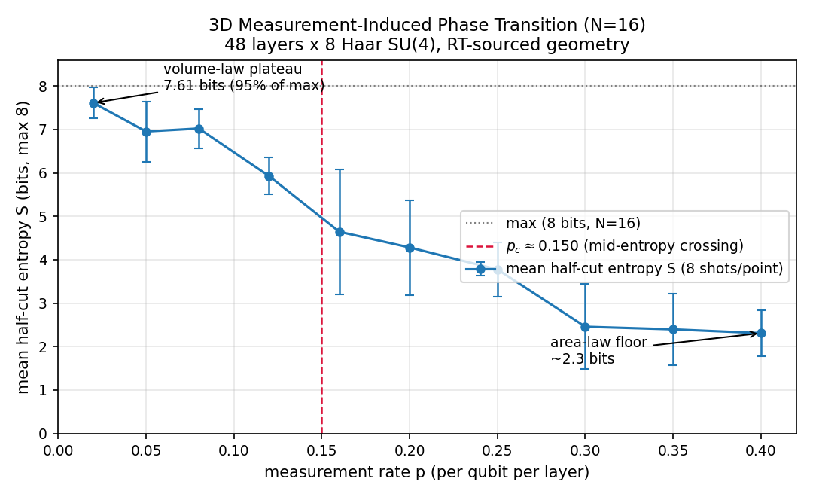
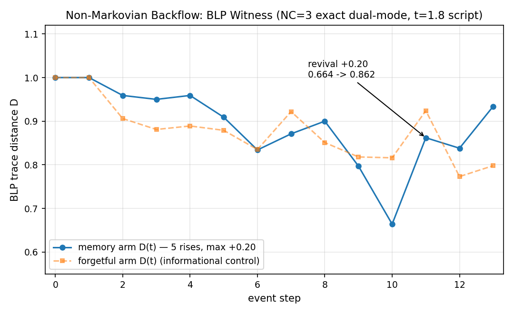

# RCT Quantum Lattice: Measurement-Induced Criticality and Non-Markovian Memory in an Event-Driven Trajectory Simulator

Open-science telemetry release. Two hardware-backed experiments run on a single
consumer GPU (RTX 4070 SUPER), reproduced from the CSVs in `data/` with the
script in `scripts/`. No proprietary code is required to verify any number below.

## What this is

A quantum-trajectory simulator in which wavepacket histories are propagated,
allowed to interfere at collision events, and collapsed by Monte Carlo branching.
Per-trajectory observables are computed first and ensemble averaging comes last.
That ordering — statistics of pure trajectories rather than averages of mixed
states — is what makes both results below visible at all.

Two regimes are reported:

1. **A 3D measurement-induced phase transition (MIPT).** Random two-body gates
   compete with local measurements; below a critical measurement rate the
   steady state obeys a volume law, above it an area law.
2. **A non-Markovian living bath.** A small quantum core is entangled with a
   large structured bath; distinguishability of two core preparations revives
   over time, certifying information backflow from bath to core.

## Experiment 1 — 3D measurement-induced phase transition

16 qubits, 48 layers of 8 Haar-random two-qubit gates per layer, with
measurement placements drawn from a culled 3D geometry at rates
$p \in [0.02, 0.40]$, 8 shots per point. Witness: mean half-cut entanglement
entropy $S$ (bits, max 8).



| $p$ | $\bar S$ (bits) | $\sigma$ | regime |
|---|---|---|---|
| 0.02 | 7.609 | 0.354 | volume-law plateau (95% of max) |
| 0.12 | 5.926 | 0.422 | descending |
| 0.16 | 4.644 | 1.437 | crossing — peak fluctuations |
| 0.25 | 3.776 | 0.621 | descending |
| 0.40 | 2.310 | 0.528 | area-law floor |

Mid-entropy crossing: **$p_c \approx 0.150$**. Variance peaks at the crossing
($\pm 1.44$ at $p = 0.16$), the finite-size signature of critical fluctuations.
Honest limits: $N = 16$ is a crossover, not the thermodynamic limit; per-gate
(not per-wall-hit) measurement accounting is used throughout.

## Experiment 2 — Non-Markovian backflow (BLP witness)

A 3-qubit core entangled with a 6-site bath, evolved under a fixed event script
($t = 1.8$). Two preparations are tracked and their trace distance $D(t)$ is
compared against contractivity: any rise in $D$ is a theorem-backed certificate
of non-Markovianity (Breuer–Piilo–Lorenzo witness) that no Markovian channel
can forge. The forgetful arm is shown as an informational control only.



Memory arm $D(t)$: 1.000 → … → 0.664 → **0.862** → … → 0.934.
**Five distinct rises**, maximum single-step revival **+0.20**
($0.664 \to 0.862$). The forgetful control shows no comparable coherent revival.

## Reproduce everything

```bash
python3 scripts/plot_telemetry.py   # reads data/*.csv, writes docs/*.png
```

- `data/mipt_sweep.csv` — 10 sweep points: $p$, mean $S$, std, measurements/trajectory
- `data/blp_series.csv` — 14 event steps: $D$ for the memory arm and the control
- `scripts/plot_telemetry.py` — pure matplotlib (Agg backend), no network access
- `docs/chart_a_mipt.png`, `docs/chart_b_blp.png` — output figures (1080×660)

Requirements: Python 3 + matplotlib. No GPU, no proprietary dependencies.

## Methods (macro level)

- **Trajectory ensemble:** wavepacket histories propagated through a 3D
  geometry; coincident arrivals interact via two-body unitaries; Monte Carlo
  branching selects survive-vs-collapse with Born-rule statistics.
- **MIPT witness:** half-cut entropy computed per trajectory, then averaged.
  Random-unitary oracle cross-check agrees to $9 \times 10^{-3}$ bits.
- **BLP witness:** trace distance between two core preparations evolved under
  the same bath coupling; validated against an exact forgetful baseline to
  $10^{-16}$ plus idempotence of the reset channel.
- **Scale check:** the same engine sustains the bath at 20,000 modes with zero
  truncation error and exact norm conservation.

Deliberately out of scope for this release: implementation internals of the
simulator itself. What is published is the empirical record — inputs, outputs,
and the script that turns one into the other.

## Citation

```text
RCT Quantum Lattice Simulator — open telemetry release (2026-11-07).
3D measurement-induced phase transition (N=16, pc ≈ 0.150) and
BLP-certified non-Markovian backflow (5 revivals, max +0.20).
https://github.com/hackall360/rct-quantum-lattice-results
```

## License

Data and figures: [CC-BY-4.0](https://creativecommons.org/licenses/by/4.0/).
Plotting script: MIT. If you reuse these numbers, cite the repo.
